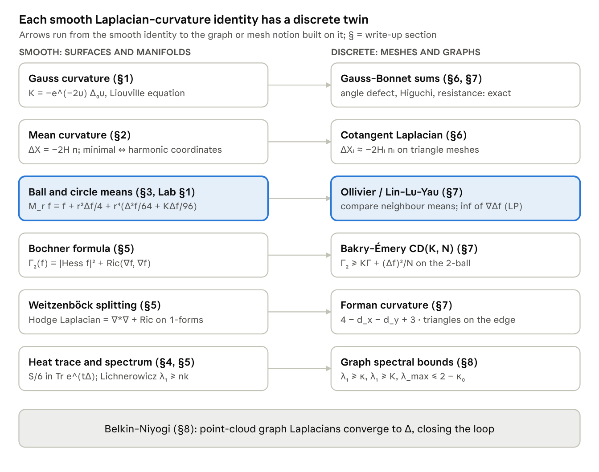

# The Laplacian and Curvature

Every standard notion of curvature, on smooth surfaces and manifolds, on triangle meshes and on graphs, can be read off the Laplacian. This repository collects those instances, with a computed check for each one.

It is a companion to **Laplacian Lab** and the Computational Classnotes notebook *Where did Laplacian come from? Laplacian things… Computational conception of Laplacian Operator (fully coded) β1.0* (DOI 10.13140/RG.2.2.33742.01600).

## Contents

| Path | What it is |
| --- | --- |
| `docs/laplacian-curvature.md` | The write-up: nine sections, verified results table, references |
| `docs/laplacian-curvature.pdf` | The same write-up as an A4 PDF (7 pages) |
| `docs/relationship-map.png` | The relationship map above |
| `notebooks/LaplacianCurvature.nb` | Wolfram notebook, one section per relationship, each ending in a check |
| `notebooks/LaplacianCurvature.wl` | The same code as a plain Wolfram Language package/script |
| `tools/pdf-style.css` | Stylesheet for the PDF: `pandoc docs/laplacian-curvature.md -s --mathml --css tools/pdf-style.css`, then print with headless Chrome |
| `tools/cells.py`, `tools/build.py` | Notebook source and builder: edit `cells.py`, then `python3 tools/build.py notebooks` |
| `STYLE.md` | House style for Computational Classnotes math documents |
| `CONTEXT.md` | Working context for the Laplacian Lab project: deliverables, decisions, lessons, open issues |

## What is covered

| Write-up § | Notebook § | Relationship | Check |
| --- | --- | --- | --- |
| 1 | 2 | Gauss curvature K = −e^(−2u) Δ₀u (Liouville) | sphere 1, hyperbolic −1, generic u agrees with Riemann tensor |
| 2 | 3 | Mean curvature ΔX = −2H n | sphere, torus, catenoid (H = 0) |
| 3 | 4 | Curved mean-value expansion (Gray–Willmore), ball volumes | exact to r⁶ on S² for a non-symmetric function |
| 4 | 5 | Heat trace: scalar curvature is audible (McKean–Singer) | t·Tr e^(tΔ) on S² vs 1 + t/3 + t²/15 |
| 5 | 6 | Bochner formula, Lichnerowicz, Laplacian comparison | symbolic Bochner identity for arbitrary f on S² |
| 6 | 7 | Cotangent Laplacian, angle defect, discrete Gauss–Bonnet | 400-vertex sphere: χ = 2.000000, K ≈ 1.01, H ≈ 1.01 |
| 7 | 8 | Graph curvatures: Ollivier, Lin–Lu–Yau, Bakry–Émery, Forman, resistance, Steinerberger, Higuchi | LLY by LP and by transport agree; Σ resistance curvature = 1; Higuchi totals = 2 |
| 8 | 9 | Discrete Lichnerowicz bounds; point-cloud Laplacian → Δ (Belkin–Niyogi) | bounds hold on 5 graphs; ratio 0.9997 on 20 000 points of S² |

## Running the notebook

Open `notebooks/LaplacianCurvature.nb` in Mathematica (or upload it to Wolfram Cloud) and evaluate it top to bottom. Sections 2–6 use the toolkit defined in Section 1, and Section 9 uses the graph functions of Section 8. Requires Wolfram Language 13 or later (`LinearOptimization`, `SpherePoints`). The script version runs with `wolframscript -file notebooks/LaplacianCurvature.wl`.

## Conventions

- Δ = div grad (the analyst's sign), so Δ ≤ 0 on a closed manifold.
- On graphs, Δf(x) = (mean of f over the neighbours of x) − f(x); eigenvalues are those of the normalised Laplacian I − D^(−1/2) A D^(−1/2).

---

© 2026 Computational Classnotes · CC BY-NC-SA 4.0
