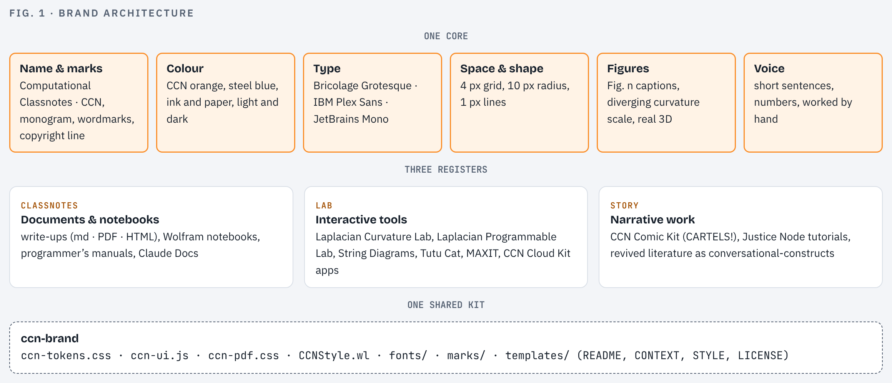
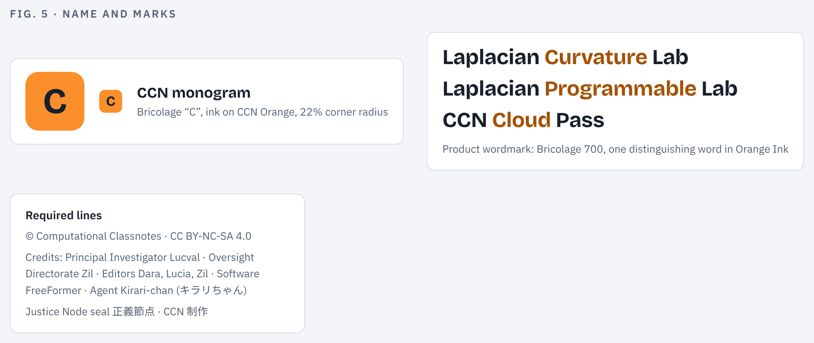
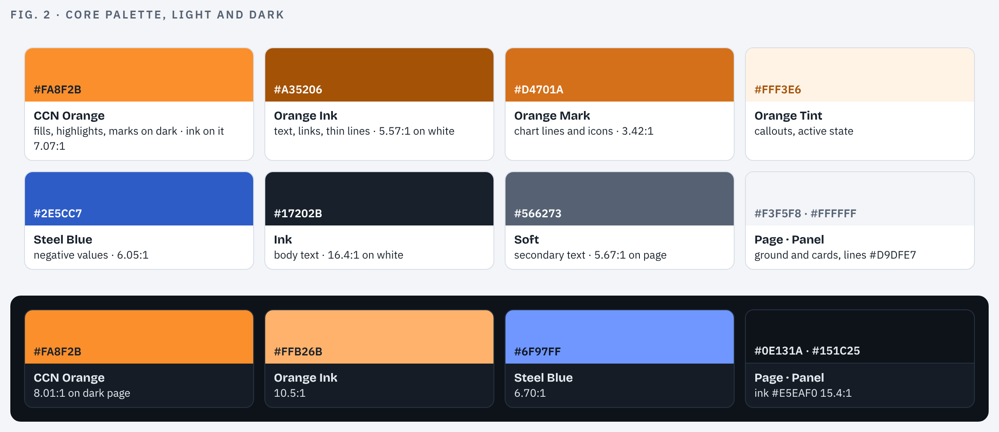
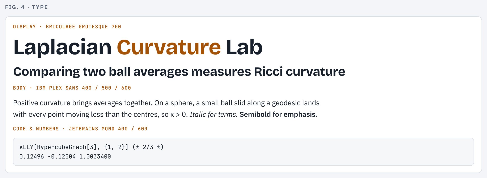
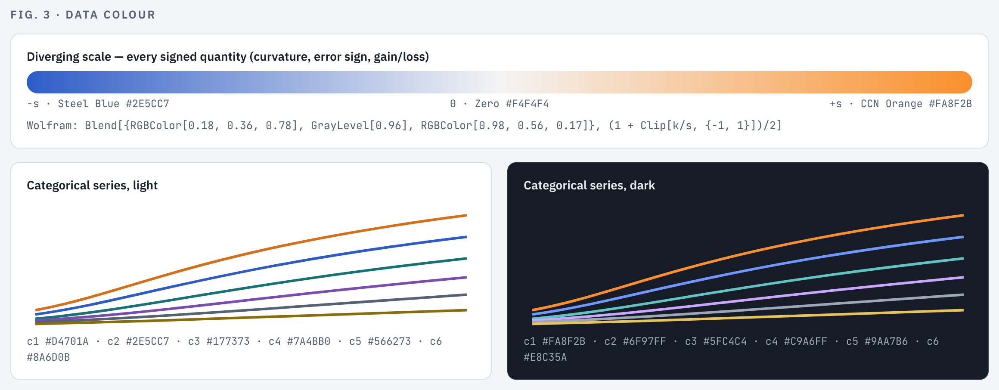
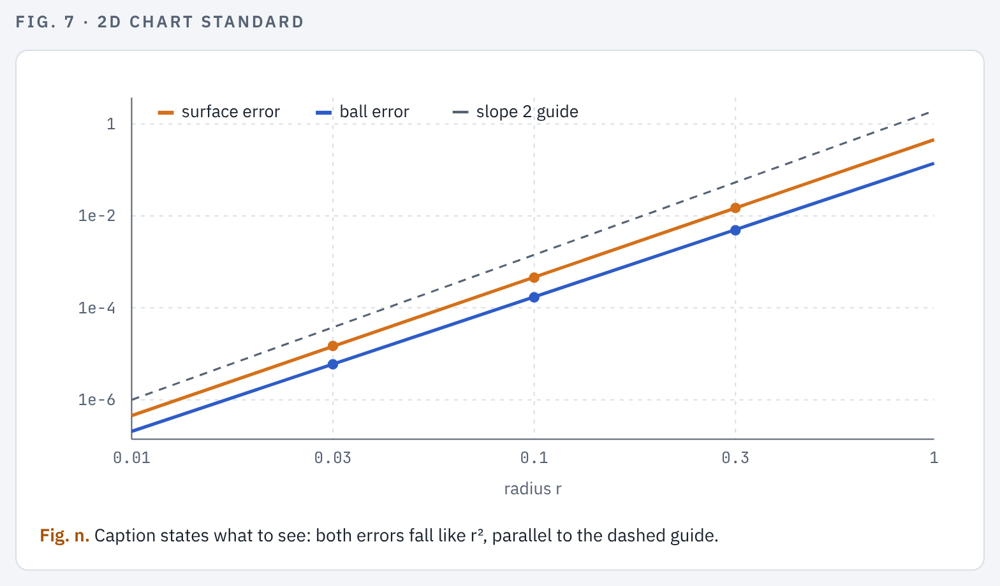
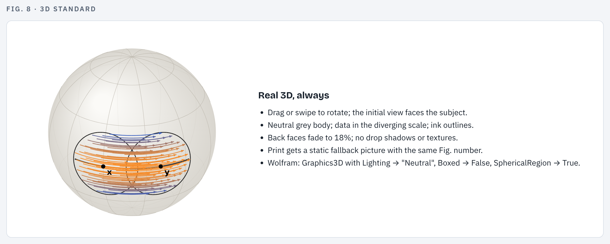
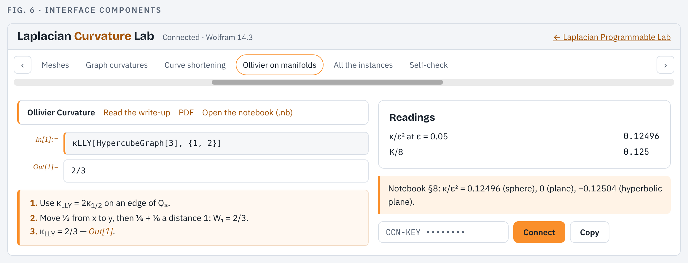

# CCN Brand Strategy

By Dara O Shayda and Hikari Noor Hoshino (星野ヌール)  
AI System Programming Group

23 November 2026 · Computational Classnotes · all lossofgenerality projects

One core, three registers and one shared kit: every Computational Classnotes project should look and read as one body of work. This document audits the branding that grew up in the Laplacian projects, fixes the places where it drifted, and specifies colour, type, marks, 2D and 3D figures, interface and experience rules for every repository. A shared `ccn-brand` kit carries the rules as code, so each project pulls the same tokens instead of copying them by hand.

## Scope and conventions

- **What counts as CCN.** Everything published as Computational Classnotes or Justice Node: the 33 lossofgenerality repositories, their GitHub Pages sites, PDFs, Wolfram notebooks, Claude Docs and artifacts.
- **Source of truth.** The tokens in §4–§6 are written once in `brand/ccn-tokens.css`. The JSON, Wolfram and PDF versions are generated from it.
- **Light and dark.** Every colour has a light and a dark value. Pages follow the reader’s system setting, with an optional `data-theme` override.
- **Contrast.** Numbers are WCAG 2 contrast ratios, computed from the hex values. WCAG asks for 4.5:1 for body text, 3:1 for large text and 3:1 for icons, graph marks and UI parts.
- **Evidence.** §2 is an audit of the Laplacian Curvature Lab, Laplacian Programmable Lab, both programmer’s manuals, the write-ups, the notebooks and the PDF stylesheet, read from their source files on 23 November 2026.

## At a glance

**One core, expressed in three registers, delivered by one kit.**

**Fig. 1.** Brand architecture. The core never changes between projects; the register changes the density and tone; the kit makes it automatic.

## 1. Brand idea: computation you can check by hand

CCN work has a consistent promise. Every claim is computed, every computation can be followed by hand, and every page credits its makers.

The visual brand serves that promise. It should feel like a careful lab notebook: quiet paper and ink, one warm signal colour for what matters, and numbers set so they can be compared.

Three words guide every decision:

- **Exact.** Real values, real subscripts, numbered figures, and no decoration that carries no information.
- **Warm.** CCN Orange, friendly display type, plain language and named characters.
- **Open.** Single-file pages that work offline, CC BY-NC-SA licensing, readable source and accessible contrast.

## 2. Audit: what the Laplacian projects use today

The core is already shared, but three surfaces drifted apart. The orange appears in four variants, the blue in three, and the typefaces in three families.

| Surface | Orange (accent) | Blue (negative) | Display / body / mono | Notes |
|---|---|---|---|---|
| Laplacian Curvature Lab | #FA8F2B, text #B85A05 | #2E5CC7 | Bricolage · IBM Plex Sans · JetBrains Mono | light-dark() tokens |
| Laplacian Programmable Lab | #E07A12, text #A8560A | #2C6DB0 | Bricolage · IBM Plex Sans · JetBrains Mono | separate token names |
| Programmer’s manuals | #D4561C, #F7A440 | link blue #1F5FA8 | Source Sans 3 · Source Code Pro (never loaded) | dark header #2B2B2E |
| Write-up PDFs | rgb(250, 143, 43) | — | DejaVu Sans · Latin Modern Math | system fonts only |
| Wolfram notebooks | RGBColor[0.98, 0.56, 0.17] | RGBColor[0.18, 0.36, 0.78] | Default.nb | κColour scale |

Three findings matter most:

- **The brand orange fails as text.** #FA8F2B on white is 2.33:1, below both 4.5:1 and 3:1. The Programmable Lab and manual accents fail as text on white too: #E07A12 is 3.02:1 and #D4561C is 4.08:1.
- **The PDF and manual fonts are not the brand fonts.** The manuals name Source Sans 3 but never load it, so readers see a fallback; the PDFs use DejaVu.
- **The 3D look is unspecified.** Each 3D figure was styled on its own.

**Checked:** the contrast ratios above were computed from the hex values. #B85A05 is 4.66:1 on white but 4.27:1 on the #F3F5F8 page, so it fails there too.

## 3. Name, marks and required lines

**Names.** Write “Computational Classnotes” in full at first mention and in footers; “CCN” is the short form. Product names follow one pattern: a plain noun phrase with one distinguishing word, such as Laplacian **Curvature** Lab, Laplacian **Programmable** Lab and CCN **Cloud** Pass.

**Monogram.** A Bricolage Grotesque “C” in ink on a CCN Orange rounded square, with a 22% corner radius. It is used for favicons, app icons and the manual header. Minimum size is 16 px, and the clear space around it is a quarter of its width.

**Wordmark.** Bricolage Grotesque 700, letter-spacing −0.01em, with the distinguishing word in Orange Ink (Orange in dark mode). Never stretch it, outline it or put it on a photograph.

**Required lines.**

- Every page, PDF, notebook and repository ends with: © Computational Classnotes · CC BY-NC-SA 4.0.
- Authored documents carry the byline under the title, with the group title on its own line under the names:
  By Dara O Shayda and Hikari Noor Hoshino (星野ヌール)  
  AI System Programming Group
- Story and tutorial work carries the production credits: Principal Investigator Lucval; Oversight Directorate Zil; Editors Dara, Lucia, Zil; Software FreeFormer; Agent Kirari-chan (キラリちゃん).
- Justice Node work may carry the 正義節点 seal with “CCN 制作”.

**Fig. 5.** Monogram, product wordmarks and the required lines.

## 4. Colour

**One signal, one counter-signal, quiet neutrals.** CCN Orange marks what matters: the active tab, the key word, positive values and the primary button. Steel Blue is its opposite: negative values and the cold end of every scale. Everything else is ink on paper.

The orange is split into four roles so it stays recognisable and still passes contrast:

| Role | Light | Dark | Use |
|---|---|---|---|
| Orange | #FA8F2B | #FA8F2B | fills, the monogram, the active tab, marks on dark |
| Orange Ink | #A35206 | #FFB26B | text, links, thin lines |
| Orange Mark | #D4701A | #FA8F2B | chart lines, icons, outlines |
| Orange Tint | #FFF3E6 | #2A1D10 | callouts, the active ground |

**Fig. 2.** Core palette in light and dark, with the contrast each pairing reaches.

Rules:

- **Text in orange uses Orange Ink:** 5.57:1 on white, 5.10:1 on the page, 10.5:1 (as #FFB26B) on the dark page.
- **Orange fills carry ink, not white.** Ink on Orange is 7.07:1; white on Orange is 2.33:1 and is not allowed, logos excepted.
- **Links are Orange Ink and underlined.** Blue is reserved for data, so a blue word never means “click me”.
- **Semantic colours** are used only for status: Good #1F7A3A, Bad #B3261E, Caution #8A6D0B, each with its own dark value.

**Checked:** Ink on white 16.43:1; Soft on page 5.67:1; Steel Blue on white 6.05:1; dark Steel Blue #6F97FF on #0E131A 6.70:1; Orange Mark on white 3.42:1.

## 5. Typography

**Three families, all under the SIL Open Font License.**

- **Display:** Bricolage Grotesque 700 for wordmarks, page titles and section headings. Its warmth is the brand’s voice.
- **Body:** IBM Plex Sans 400, 500 and 600 for reading and interface text. It is neutral, has true italics and covers many languages.
- **Code and numbers:** JetBrains Mono 400 and 600 for code, readings, Out cells and tables of values.
- **Mathematics:** MathJax TeX fonts on the web, Latin Modern Math in PDFs, and Wolfram’s own fonts in notebooks.

**Fig. 4.** Type specimen: display, body and mono in their roles.

Rules:

- **Ship the fonts with the site.** Self-host the woff2 files from `ccn-brand/fonts` (taken from the Fontsource packages) instead of calling Google Fonts. Pages then work offline, behind firewalls and in PDFs, and the PDF build embeds the real brand type.
- **Scale:** 12 · 13.5 · 16 · 20 · 26–36 · 30–48 px. Body is 16 px with line-height 1.55, and reading lines are at most 72 characters.
- **Numbers that are compared are mono,** right-aligned, with the true minus sign (−) and a fixed number of digits per column.
- **Subscripts are real.** Use `` in HTML, LaTeX in markdown, `SubscriptBox` in notebook text and `Subscript[]` in Wolfram code; never type `κ_LLY` as plain text.
- **Other scripts:** IBM Plex Sans Arabic, IBM Plex Sans JP and Noto Sans SC sit beside Plex for multilingual pages such as MAXIT. Arabic pages set `dir="rtl"`.
- **Story register exception:** the Comic Kit keeps its own comic faces (Bangers, Comic Neue) for panels. Its credits page, footer and copyright line return to the core type.

## 6. Data colour and the diverging scale

**Every signed quantity uses one scale: Steel Blue through near-white to CCN Orange.** Curvature, signed error, gain and loss all read the same way across every project, and the Wolfram, JavaScript and CSS versions are the same three colours.

In Wolfram, `ccnColour[k, s]` is `Blend[{RGBColor[0.18, 0.36, 0.78], GrayLevel[0.96], RGBColor[0.98, 0.56, 0.17]}, (1 + Clip[k/s, {-1, 1}])/2]`; in CSS and JavaScript the same three stops are #2E5CC7, #F4F4F4 and #FA8F2B, with the scale s fixed per figure and shown on its bar legend.

**Fig. 3.** The diverging scale and the six categorical series, light and dark.

- **Categorical series** follow a fixed order: c1 Orange Mark, c2 Steel Blue, c3 Teal #177373, c4 Plum #7A4BB0, c5 Graphite #566273, c6 Gold #8A6D0B. On dark grounds the lighter partner of each is used.
- **Never colour alone.** A second series also changes marker or dash, so the chart still reads in greyscale and for colour-blind readers.
- **Reference lines** are Graphite, dashed 6/5; zero lines are solid Soft.

**Checked:** Teal 5.62:1, Plum 6.07:1, Graphite 6.19:1 and Gold 4.91:1 on white. All six series pass the 3:1 non-text threshold.

## 7. 2D figures

**A figure states one finding, carries a number, and is drawn from data.**

**Fig. 7.** The 2D chart standard: dashed grid in Line colour, axes in Soft, mono tick labels, a series legend above the plot, and a caption that says what to see.

- **Numbering.** Every figure is **Fig. n.** with a caption, in write-ups, notebooks, manuals and Labs. Text refers to figures by number.
- **Caption pattern.** The bold number in Orange Ink, then one sentence on what the reader should see.
- **Format.** Use inline SVG on web pages; use PNG at 2× for PDFs and Markdown, at least 1600 px wide; use native Graphics in notebooks.
- **Wolfram.** One `CCNStyle.wl` sets `PlotStyle` to the categorical order, `GridLines` dashed in Line colour, `BaseStyle` with IBM Plex Sans 12, and `ImageSize` 520 for single plots. Use `Row[{…}]` for panels with legends, and `Subscript[]` in labels.
- **Graphs.** Vertices are Graphite dots and edges 1.2 px lines. When a value is shown it uses the diverging scale, with a bar legend.

## 8. 3D figures

**Real 3D, always.** A 3D figure is rotatable on every screen, and has a static picture only where the medium cannot move.

**Fig. 8.** The 3D standard, shown on the Ollivier sphere. In the HTML version of this document it can be dragged.

- **Body and light.** A neutral grey body with a soft radial light, no textures and no drop shadows. Data is drawn in the diverging scale and outlines in ink.
- **Depth.** Back faces and hidden lines fade to 18% instead of disappearing, so the shape stays readable.
- **Interaction.** Drag with a mouse or swipe on touch. The first view faces the subject. With reduced motion there is no auto-spin.
- **Technology.** Use a small canvas renderer (as in `fig3d.js`) for diagrams, and WebGL (three.js) for heavy scenes such as tatreez-flag. In Wolfram, use `Graphics3D` with `Lighting → "Neutral"`, `Boxed → False` and `SphericalRegion → True`.
- **Print.** The PDF carries the same view as a PNG with the same Fig. number. The HTML version is the reference.

## 9. Interface components

**One component set for every Lab and app.**

**Fig. 6.** Header with wordmark, status and companion link; tab strip with ‹ › buttons and the drawn slider; link bar; In/Out cells; Worked by Hand; readings card; check callout; CCN-KEY field and buttons.

- **Header.** Wordmark on the left, connection status beside it, and the companion link on the right. It is sticky, with a blurred page-coloured background.
- **Navigation.** On wide screens a tab strip or sidebar. On narrow screens, a single-row strip with ‹ › buttons and a drawn slider; the current tab is always scrolled into view.
- **Sliders.** Anything wider than its box gets a drawn slider (track and thumb), which works in every browser, including Firefox and macOS overlay scrollbars. Tall boxes get it at the top.
- **Cards.** A Panel background, a 1 px Line border, 10 px radius and 16–18 px padding. A **check callout** has an Orange left rule on Orange Tint, for verified numbers.
- **Code cells.** In[n]:= / Out[n]= labels in italic serif Orange Ink. The input has an Orange left rule, and the output sits on Panel. Every cell has a Copy button.
- **Buttons.** The primary button is ink on CCN Orange; the secondary is ink on Panel with a Line border. There is one primary per view.
- **Keys and secrets.** A single masked CCN-KEY field with Connect and an optional “Remember on this device”. Keys are never stored in files.
- **Worked by Hand.** Numbered steps on a warm tint with an Orange left rule, ending at a highlighted Out[n]. Every manual page and write-up has one.

## 10. Experience principles

1. **One file, works anywhere.** A Lab, manual or app is a single self-contained HTML page, with fonts and scripts inlined at build time. It runs offline, from GitHub Pages or as a Claude artifact.
2. **Hash-routed sections.** Show one section at a time with pagers and deep links (`#ollivier`, `#/ref/κLLY`). The back button always works.
3. **Mobile first.** Respect safe areas, use touch targets of at least 30 px, use no hover-only controls, and render only nearby pages in heavy books.
4. **Show the computation.** Every number on screen can be traced to a notebook section, a Worked by Hand derivation or a kernel cell.
5. **Accessible by default.** Meet 4.5:1 text and 3:1 non-text contrast, keep focus rings visible, use ARIA labels on controls, respect reduced motion, and set `lang`/`dir` per language.
6. **Installable where useful.** Apps such as Tutu Cat, MAXIT and tatreez-flag ship a manifest, the monogram icon and a theme colour of CCN Orange.
7. **Calm motion.** Transitions last 120–240 ms and ease out. Nothing loops on mobile, and the 3D view never spins unasked.

## 11. Documents, notebooks and voice

- **Write-ups** follow `STYLE.md`: lead paragraph with the result, scope, at a glance, numbered claim-headed sections, Worked by Hand, “Checked” lines, a verified table and references actually opened. Each comes in three forms: Markdown, PDF (A4) and HTML with live 3D.
- **PDFs** use `ccn-pdf.css`: IBM Plex Sans body at 10.5 pt, Bricolage headings, h2 with a 2 px Orange rule, mono tables and the copyright footer on every page.
- **Notebooks** open with Title, Subtitle and copyright cells, use Text cells with real subscripts, add a bold Fig. n caption after every figure, end every section in a check, and repeat the copyright at the end.
- **Voice.** Short plain sentences under 25 words, numbers over adjectives, claims as headings. Use “conversational-construct”, never “LLM”.

## 12. Repository conventions

Every CCN repository has the same front door:

- **Files.** `README.md` (one-line promise, live link, contents table), `CONTEXT.md` (state, decisions, open issues), `STYLE.md` (or a link to the kit’s), `LICENSE.md` (CC BY-NC-SA 4.0), and `.nojekyll` when the site is served by GitHub Pages.
- **Names.** Use `ccn-` plus a kebab-case noun for new repositories (`ccn-string-diagrams`, `ccn-keypad`). Keep the historical names that are already published.
- **Site.** GitHub Pages from `main` / root, with `index.html` as the entry. Add a social preview image at 1280×640: the wordmark on Page with an Orange rule.
- **Commits.** Authored and committed as Noor Hoshino <noor@compclassnotes.com>, with no assistant attribution lines.
- **Secrets.** No keys in any file. Kernels hold their secrets in private Wolfram Cloud objects.

## 13. The shared kit: ccn-brand

A new public repository, `lossofgenerality/ccn-brand`, holds the rules as code. Version 1 is in this repository’s `brand/` folder, ready to move:

| File | Contents |
|---|---|
| `ccn-tokens.css` | Colour, type, space, radius and motion tokens with light-dark(); @font-face for the self-hosted fonts |
| `fonts/` | Bricolage Grotesque 400/700, IBM Plex Sans 400/400i/500/600, JetBrains Mono 400/600 (woff2) with their OFL licences |
| `ccn-ui.js` (next) | Drawn sliders and tab arrows (from `hscroll.js`), theme toggle, Copy buttons, rotatable 3D (`fig3d.js`) |
| `ccn-pdf.css` (next) | The PDF stylesheet on the brand fonts |
| `CCNStyle.wl` (next) | `$CCNColors`, `ccnColour[k, s]`, `ccnLegend`, plot options and a notebook stylesheet |
| `templates/` (next) | README, CONTEXT, STYLE and LICENSE templates; a blank Lab page; a write-up skeleton |
| `specimen.html` | The live specimen behind Fig. 1–8 |

Pages keep the single-file rule: each project’s build script inlines the kit at a pinned version, and the version number goes in the page footer.

## 14. Worked by hand: bringing one page onto the brand

Take the Laplacian Programmable Lab as an example, and change it in five steps:

1. Replace its token block (`--accent #E07A12`, `--cold #2C6DB0`) with `ccn-tokens.css`. The accent text becomes Orange Ink #A35206, which raises its contrast on white from 3.02:1 to 5.57:1.
2. Map the old names to the new ones: `--accent` → `--ccn-orange`, `--accent-ink` → `--ccn-orange-ink`, `--cold` → `--ccn-blue`, `--surface` → `--ccn-panel`, `--rule` → `--ccn-line`.
3. Inline the self-hosted fonts in place of the Google Fonts link, so the page works offline.
4. Swap its scroll helpers for `ccn-ui.js` (the drawn slider and the tab arrows).
5. Check: every text and background pair passes 4.5:1, every figure has a Fig. n caption, and the footer carries the copyright and the kit version.

The same five steps apply to every Lab-register project. Documents need steps 1, 3 and 5; notebooks need `CCNStyle.wl` in place of their local colour definitions.

## 15. Roll-out plan

1. **Now:** publish `ccn-brand` v1 (tokens, fonts, specimen, this document).
2. **The Laplacian projects:** both Labs, both manuals, the write-up PDFs and the notebooks adopt v1, starting with the contrast fixes and real brand fonts.
3. **CCN Cloud Kit apps:** Tutu Cat, MAXIT, CCN Camera, CCN Keypad and CCN Composite Eye adopt the header, key field, buttons and installable-app rules.
4. **Research projects:** String Diagrams, Hochschild cohomology algebras, Poisson brackets, tensor-algebra nets, polymer and neural-network repositories adopt the document, notebook and figure rules.
5. **Story projects:** the Comic Kit and Justice Node tutorials keep their register and adopt the core lines, colours and credits.
6. **Every repository:** the front-door files of §12 and a brand check before each release.

Each repository is audited against §2’s table when it is next worked on, so the roll-out never blocks other work.

## Verified values

| Pairing | Foreground | Background | Contrast | Passes |
|---|---|---|---|---|
| Body text | Ink #17202B | Panel #FFFFFF | 16.43:1 | text AAA |
| Secondary text | Soft #566273 | Page #F3F5F8 | 5.67:1 | text AA |
| Orange text (old) | #B85A05 | Page #F3F5F8 | 4.27:1 | fails text |
| Orange text (new) | Orange Ink #A35206 | Page #F3F5F8 | 5.10:1 | text AA |
| Orange as text | Orange #FA8F2B | Panel #FFFFFF | 2.33:1 | fails |
| Text on orange | Ink #17202B | Orange #FA8F2B | 7.07:1 | text AAA |
| Chart line | Orange Mark #D4701A | Panel #FFFFFF | 3.42:1 | non-text |
| Negative value | Steel Blue #2E5CC7 | Panel #FFFFFF | 6.05:1 | text AA |
| Dark body text | #E5EAF0 | Dark page #0E131A | 15.41:1 | text AAA |
| Dark orange text | #FFB26B | Dark page #0E131A | 10.50:1 | text AAA |
| Dark negative | #6F97FF | Dark page #0E131A | 6.70:1 | text AA |

The only failures are the two old orange uses in the audit, and §4 retires both.

## References

**Accessibility**

- W3C, *Understanding Success Criterion 1.4.3: Contrast (Minimum)*, WCAG 2.2. [w3.org](https://www.w3.org/WAI/WCAG22/Understanding/contrast-minimum.html).
- MDN, *Color contrast*. [developer.mozilla.org](https://developer.mozilla.org/en-US/docs/Web/Accessibility/Understanding_WCAG/Perceivable/Color_Contrast).

**Typefaces**

- Bricolage Grotesque, Atelier Triay. [github.com/ateliertriay/bricolage](https://github.com/ateliertriay/bricolage) (SIL Open Font License 1.1).
- IBM Plex, IBM. [ibm.com/design/language/typography/typeface](https://www.ibm.com/design/language/typography/typeface) (SIL Open Font License; “Plex” is a reserved font name).
- JetBrains Mono, JetBrains (SIL Open Font License 1.1).
- Fontsource packages @fontsource/bricolage-grotesque, @fontsource/ibm-plex-sans and @fontsource/jetbrains-mono (npm), the source of the self-hosted woff2 files.

**CCN sources audited**

- `lab/template.html`, Laplacian Curvature Lab; `index.html`, Laplacian Programmable Lab; `tools/manual/build_manual.py`; `tools/pdf-style.css`; `tools/cells.py` (κColour); `STYLE.md`.

© Computational Classnotes · CC BY-NC-SA 4.0
