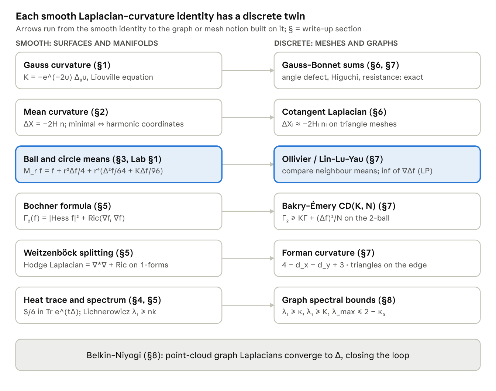

# The Laplacian and Curvature — Instances and Relationships

23 November 2026 · Computational Classnotes · Laplacian Lab

Curvature is what the Laplacian sees beyond its flat value. On smooth surfaces and manifolds, on triangle meshes and on graphs, every standard notion of curvature can be read off the Laplacian, its mean values, its heat flow, its Bochner identity or its spectrum. This write-up lists those instances. Each one has a matching section and check in the companion notebook `notebooks/LaplacianCurvature.nb`, and every check below was run on a Wolfram kernel. The notebook also draws each instance: surfaces coloured by K and H, error plots for the curved mean value, heat traces of two same-area drums, a torus mesh, and seven example graphs coloured by each graph curvature.

## Scope and conventions

- **Sign.** Δ = div grad (the analyst's sign), so Δ ≤ 0 on a closed manifold and its eigenvalues are written −λ with λ ≥ 0.
- **Graphs.** Δf(x) = (mean of f over the neighbours of x) − f(x), the random-walk normalisation. Its spectrum is that of the normalised Laplacian I − D^(−1/2) A D^(−1/2), up to sign.
- **Notebook map.** Sections 1–8 here ↔ notebook Sections 2–9; Section 10 ↔ notebook Section 10. Notebook Section 1 is a shared Riemannian toolkit: Laplace–Beltrami, Christoffel symbols, covariant Hessian, Gauss curvature.

## At a glance

The highlighted row is the thread from Laplacian Lab Section 1: the mean-value origin of Δ is also where curvature first appears, both on manifolds and on graphs.

## 1. Gauss curvature is a Laplacian

In isothermal coordinates, Gauss curvature is the flat Laplacian of the log conformal factor, rescaled. For g = e^(2u)(dx² + dy²):

$$K = -e^{-2u}\,\Delta_0 u, \qquad \Delta_0 u + K e^{2u} = 0 \;\; \text{(Liouville's equation when } K \text{ is constant)}$$

The same identity gives the 2-D Ricci flow ∂u/∂t = e^(−2u)Δ₀u = −K, a nonlinear heat equation, and in dimension n it generalises to the Yamabe equation for prescribed scalar curvature.

**Checked (notebook §2):** stereographic sphere K = 1, Poincaré half-plane and disc K = −1, and agreement with the Riemann-tensor computation for an arbitrary u(x, y).

## 2. Mean curvature is a Laplacian

Applied to the position vector of an immersed surface, the Laplace–Beltrami operator returns the mean-curvature vector:

$$\Delta_g X = -2H\,\mathbf{n}$$

So a surface is minimal exactly when its coordinate functions are harmonic (Takahashi), and mean-curvature flow ∂X/∂t = ΔX is the heat equation for the embedding. The tangential part of ΔX is identically zero.

**Checked (notebook §3):** sphere of radius 3 gives H = 1/3; torus (R = 2, r = 1) gives H = 2cos²(v/2)/(2 + cos v); catenoid gives H = 0.

## 3. Mean values and volumes: where Laplacian Lab Section 1 meets curvature

Laplacian Lab Section 1 obtains Δ from the flat sphere mean, M_r f = f + r²Δf/(2n) + …. On a curved space the same expansion carries curvature from order r⁴ on (Gray–Willmore 1982). On a surface of constant curvature K the geodesic-circle mean is:

$$M_r f = f + \frac{r^2}{4}\Delta f + r^4\Big(\frac{\Delta^2 f}{64} + \frac{K\,\Delta f}{96}\Big) + r^6\Big(\frac{\Delta^3 f}{2304} + \frac{K\,\Delta^2 f}{1152} + \frac{K^2\Delta f}{1440}\Big) + O(r^8)$$

The coefficients come from the series of P_l(cos r), the eigenvalue of the circle-mean operator on spherical harmonics, rewritten in λ = −l(l+1). Volumes carry curvature at order r²:

$$A(r) = \pi r^2\Big(1 - \frac{K r^2}{12} + \frac{K^2 r^4}{360} - \dots\Big), \qquad \operatorname{Vol} B_r = \omega_n r^n\Big(1 - \frac{S\,r^2}{6(n+2)} + O(r^4)\Big)$$

Here S is the scalar curvature. Ollivier's curvature (Section 7) is the same idea applied to two nearby balls: on a manifold, comparing averages over balls of radius ε at points a distance δ apart along v gives κ ≈ ε² Ric(v, v)/(2(n+2)).

**Checked (notebook §4):** the Legendre coefficients 1/64, 1/96, 1/2304, 1/1152 and 1/1440 are exact. A direct average of the non-symmetric function eˣ(1+z)² + yz³ over geodesic circles on S² matches the formula through r⁶ with zero remainder. The disc-area series and the S³ ball-volume coefficient −1/5 = −6/(6·5) also match.

## 4. Heat kernel and spectrum: curvature is audible

The trace of the heat semigroup encodes curvature in its short-time expansion (Minakshisundaram–Pleijel; McKean–Singer 1967):

$$\operatorname{Tr} e^{t\Delta} = \sum_k e^{-\lambda_k t} \sim (4\pi t)^{-n/2}\Big(\operatorname{Vol}(M) + \frac{t}{6}\int_M S + O(t^2)\Big)$$

The local coefficient is S(x)/6. For a surface, ∫S = 2∫K = 4πχ, so the eigenvalues determine the Euler characteristic. Weyl's law is the leading term.

**Checked (notebook §5):** on the unit S² (eigenvalues l(l+1), multiplicity 2l+1), t·Tr e^(tΔ) = 1.003340 at t = 0.01, against 1 + t/3 + t²/15 = 1.003340.

## 5. Bochner formula and its consequences

Bochner's identity ties the Laplacian of the energy density to Ricci curvature:

$$\tfrac12\,\Delta|\nabla f|^2 = |\operatorname{Hess} f|^2 + \langle \nabla f, \nabla \Delta f\rangle + \operatorname{Ric}(\nabla f, \nabla f)$$

In Bakry–Émery's Γ-calculus it reads Γ₂(f) = |Hess f|² + Ric(∇f, ∇f), and the bound Ric ≥ K becomes Γ₂ ≥ KΓ + (Δf)²/n. This is the form graphs copy (Section 7). Consequences:

- **Lichnerowicz:** Ric ≥ (n−1)k > 0 gives λ₁ ≥ nk, with equality only on the round sphere (Obata).
- **Laplacian comparison:** Ric ≥ 0 gives Δr ≤ (n−1)/r for the distance r. Δr is the mean curvature of geodesic spheres, which leads to Bishop–Gromov volume comparison.
- **Li–Yau gradient estimate** for positive heat solutions under Ric ≥ 0.
- **Weitzenböck on 1-forms:** Δ_Hodge = ∇\*∇ + Ric, so Ric > 0 forces b₁ = 0 (Bochner's theorem). Forman's graph curvature (Section 7) discretises this splitting.

**Checked (notebook §6):** Bochner holds symbolically for an arbitrary f(θ, φ) on S². λ₁(S²) = 2 = nk, the equality case. Δr = cot r ≤ 1/r on (0, π).

## 6. Discrete surfaces: the cotangent Laplacian

On a triangle mesh the cotangent Laplacian, divided by the vertex area, discretises Δ (Pinkall–Polthier; Meyer–Desbrun–Schröder–Barr):

$$(\Delta f)_i = \frac{1}{2A_i}\sum_{j\sim i}(\cot\alpha_{ij} + \cot\beta_{ij})(f_j - f_i), \qquad \Delta X_i \approx -2H_i\,\mathbf{n}_i, \qquad K_i \approx \frac{2\pi - \sum \theta_i}{A_i}$$

The angle defect sums to exactly 2πχ, a discrete Gauss–Bonnet theorem. No discrete Laplacian keeps every smooth property at once: symmetry, locality, linear precision, semidefiniteness and the maximum principle (Wardetzky et al. 2007). This connects to the Lab's Section 5 "orthonormal mandate".

**Checked (notebook §7), 400-vertex sphere mesh:** Σ defect/2π = 2.000000, mean K = 1.014, mean H = 1.006.

## 7. Graph curvatures and the graph Laplacian

Every graph curvature in use copies one smooth relationship from Sections 1–5, and each is computed from Δ, its random walk, or its pseudoinverse.

| Curvature | Smooth relationship it copies | Defined on | Built from the Laplacian via |
| --- | --- | --- | --- |
| Ollivier (2009) | Ball means at nearby points (§3) | edges, pairs | W₁ distance between random-walk measures μ_x = averaging kernel of Δ |
| Lin–Lu–Yau (2011) | same, infinitesimal laziness | edges | κ = inf { ∇_xy Δf : f 1-Lipschitz, ∇_yx f = 1 } (Münch–Wojciechowski 2019) |
| Bakry–Émery CD(K,N) (Lin–Yau 2010) | Bochner, Γ₂ ≥ KΓ + (Δf)²/N (§5) | vertices | Γ, Γ₂ computed from Δ on the 2-ball |
| CDE / CDE′ (Bauer et al. 2015) | Bochner + chain rule, for Li–Yau | vertices | modified Γ₂ with Δ√f |
| Forman (2003) | Weitzenböck: Hodge = rough + curvature (§5) | edges, cells | diagonal of the 1-form Hodge Laplacian; 4 − d_x − d_y + 3·#triangles |
| Entropic (Erbar–Maas 2012) | Ricci ⇔ entropy convexity (Lott–Sturm–Villani) | whole chain | heat flow e^(tΔ) as a gradient flow of entropy |
| Resistance (Devriendt–Lambiotte 2022) | Gauss–Bonnet (§6) | vertices, edges | effective resistance from L⁺; p_i = 1 − ½ Σ_{j~i} ω_ij |
| Steinerberger (2023) | Bonnet–Myers / mean distance | vertices | D·K = n·1 with D the distance matrix |
| Combinatorial (Higuchi 2001) | Gauss–Bonnet on polyhedra | vertices | 1 − d/2 + Σ 1/face size; total = χ |

Two results make the link to Section 3 explicit. Ollivier curvature compares averages over two neighbouring balls, as the smooth expansion does. Münch–Wojciechowski turn it into an optimisation of ∇Δf, so curvature is literally the gradient of the Laplacian of a test function. Foster's theorem Σ_edges ω = n − 1 makes Σ p_i = 1 on every connected graph.

## 8. Spectral consequences on graphs, and the limit back to manifolds

Graph curvature lower bounds give Lichnerowicz-type bounds on the normalised Laplacian, as in Section 5:

- **Ollivier / Lin–Lu–Yau:** κ ≥ k > 0 on all edges gives λ₁ ≥ k. With κ₀ the non-lazy Ollivier curvature, λ_max ≤ 2 − κ₀ (Ollivier; Bauer–Jost–Liu, with t-step refinements).
- **Bakry–Émery:** CD(K, ∞) gives λ₁ ≥ K, and CD(K, n) gives λ₁ ≥ nK/(n−1) (Lin–Yau; Bauer–Chung–Lin–Liu).
- **Diameter:** positive curvature bounds diameter (discrete Bonnet–Myers: Lin–Lu–Yau; Liu–Münch–Peyerimhoff).
- **Heat flow:** CDE(0, n) gives a Li–Yau inequality and polynomial volume growth (Bauer–Horn–Lin–Lippner–Mangoubi–Yau).

The link runs the other way too. On points sampled from a manifold, the heat-kernel graph Laplacian (weighted mean − value)/t converges to Δ and its eigenvectors converge to eigenfunctions (Belkin–Niyogi). So the graph-side quantities above are discretisations of Sections 1–5, not only analogies.

**Checked (notebook §9):** all three spectral inequalities hold on the five test graphs (Section 9 table). For 20 000 points on S² and f = z, the point-cloud Laplacian recovers Δz = −2z with fitted ratio 0.9997 and correlation 0.99999.

## 9. Verified graph results

Computed in the notebook; all curvatures are minima over edges or vertices, and λ are eigenvalues of the normalised Laplacian. Lin–Lu–Yau was computed two ways (Münch–Wojciechowski linear program and 2κ_{1/2} by optimal transport) and they agree on every graph.

| Graph | κ_LLY | κ₀ (Ollivier) | K_BE (CD(K,∞)) | Forman / augmented | min resistance p | λ₁ | λ_max |
| --- | --- | --- | --- | --- | --- | --- | --- |
| Complete K₅ | 5/4 | 3/4 | 7/8 | −4 / 5 | 0.200 | 1.250 | 1.250 |
| Cube Q₃ | 2/3 | 0 | 2/3 | −2 / −2 | 0.125 | 0.667 | 2.000 |
| Petersen | 0 | −1/3 | −1/3 | −2 / −2 | 0.100 | 0.667 | 1.667 |
| Cycle C₆ | 0 | 0 | 0 | 0 / 0 | 0.167 | 0.500 | 2.000 |
| Grid 4×4 | 0 | 0 | 0.088 | −4 / −4 | −0.112 | 0.218 | 2.000 |

Other totals: Σ resistance curvature = 1.000 on all five graphs. Higuchi curvature sums to 2 on the tetrahedron, cube, dodecahedron, icosahedron and truncated icosahedron. K₅ attains λ₁ = κ_LLY = 5/4 and Q₃ attains λ₁ = κ_LLY = K_BE = 2/3, the discrete equality cases.

## 10. Flows and further identities, worked out (notebook §10)

Five more places where curvature is a Laplacian, each computed in notebook §10.

- **Weitzenböck on 1-forms.** Δ_Hodge = ∇\*∇ + Ric. On S² every 1-form is df + ⋆dh, and Δ_Hodge commutes with d and ⋆, so the identity can be checked for arbitrary f and h. Ric > 0 then leaves no harmonic 1-forms: b₁ = 0.
- **Ricci flow** ∂g/∂t = −2Ric. In two dimensions, with g = e^(2u)(dx² + dy²), it is the heat equation ∂u/∂t = e^(−2u)Δ₀u = −K. The round sphere shrinks as (1 − 2t)g₀.
- **Mean-curvature flow** ∂X/∂t = ΔX = −2Hn. A sphere shrinks as R² = R₀² − 4t. In the plane this is curve shortening, which rounds any embedded curve (Gage–Hamilton–Grayson), and the enclosed area falls at exactly 2π per unit time.
- **Ollivier curvature on a manifold.** For uniform measures on ε-balls, sliding the surface along the geodesic carries one ball onto the other, and gives κ → ε²K/8 = ε² Ric/(2(n+2)).
- **Yamabe.** For g̃ = u^(4/(n−2)) g, scalar curvature transforms by a Laplacian. In ℝ³, S̃ = −8u^(−5)Δu.

$$\frac{\partial u}{\partial t} = e^{-2u}\Delta_0 u = -K, \qquad \frac{dA}{dt} = -\oint \kappa\,ds = -2\pi, \qquad \tilde S = u^{-\frac{n+2}{n-2}}\Big(-\tfrac{4(n-1)}{n-2}\Delta u + S u\Big)$$

**Checked (notebook §10):** Weitzenböck on S² gives difference {0, 0} for arbitrary f and h. The sphere's Ricci-flow and mean-curvature-flow solutions give residual 0. On a bumpy flat torus, max|K| falls from 4.83 at t = 0 to 0.059 at t = 2 while ∬K dA stays 0. Curve shortening of a 160-vertex polygon gives fitted dA/dt = −6.32 against −2π = −6.28. Ollivier curvature gives κ/ε² = 0.12496 (sphere), 0 (plane) and −0.12504 (hyperbolic plane) at ε = 0.05. The Yamabe factor u = (2/(1 + r²))^(1/2) gives S̃ = 6, the round S³.

## References

**Smooth**

- Gray & Willmore, Mean-value theorems for Riemannian manifolds, Proc. Roy. Soc. Edinburgh A 92 (1982) 343–364. Gray & Vanhecke, Acta Math. 142 (1979). [Cited in](https://arxiv.org/pdf/1704.07518)
- [Lei Ni, Mean value theorems on manifolds (2006)](https://arxiv.org/abs/math/0608608)
- [McKean & Singer, Curvature and the eigenvalues of the Laplacian, J. Differential Geom. 1 (1967) 43–69](https://projecteuclid.org/download/pdf_1/euclid.jdg/1214427880)
- [Bakry, Gentil & Ledoux, Analysis and Geometry of Markov Diffusion Operators, Springer Grundlehren 348 (2014)](https://link.springer.com/9783319002262)
- Chavel, Eigenvalues in Riemannian Geometry; Rosenberg, The Laplacian on a Riemannian Manifold; Schoen & Yau, Lectures on Differential Geometry (standard texts; not opened for this write-up)

**Discrete surfaces**

- [Meyer, Desbrun, Schröder & Barr, Discrete Differential-Geometry Operators for Triangulated 2-Manifolds (2003)](https://authors.library.caltech.edu/records/0rsjd-50h08)
- [Wardetzky, Mathur, Kälberer & Grinspun, Discrete Laplace operators: No free lunch, SGP 2007](https://www.cis.upenn.edu/~cis610/Wardetzky-Laplacian-07.pdf)

**Graphs**

- [Najman & Romon (eds), Modern Approaches to Discrete Curvature, Springer LNM 2184 (2017)](https://link.springer.com/book/10.1007/978-3-319-58002-9)
- [Keller, Lenz & Wojciechowski, Graphs and Discrete Dirichlet Spaces, Springer Grundlehren 358 (2021)](https://www.springer.com/book/9783030814595)
- [Ollivier, Ricci curvature of Markov chains on metric spaces, J. Funct. Anal. 256 (2009)](https://arxiv.org/abs/math/0701886)
- [Lin, Lu & Yau, Ricci curvature of graphs, Tohoku Math. J. 63 (2011)](https://www.projecteuclid.org/euclid.tmj/1325886283)
- [Lin & Yau, A brief review on geometry and spectrum of graphs (2012)](https://arxiv.org/pdf/1204.3168)
- [Bauer, Jost & Liu, Ollivier-Ricci curvature and the spectrum of the normalized graph Laplace operator](https://arxiv.org/pdf/1105.3803)
- [Jost & Liu, Ollivier's Ricci curvature, local clustering and curvature-dimension inequalities on graphs, DCG 51 (2014)](https://www.arxiv.org/abs/1103.4037)
- [Münch & Wojciechowski, Ollivier Ricci curvature for general graph Laplacians, Adv. Math. (2019)](https://arxiv.org/pdf/1712.00875)
- [Bauer, Horn, Lin, Lippner, Mangoubi & Yau, Li-Yau inequality on graphs, J. Differential Geom. 99 (2015)](https://projecteuclid.org/euclid.jdg/1424880980)
- [Bauer, Chung, Lin & Liu, Curvature aspects of graphs, Proc. AMS (2017)](https://archive.ymsc.tsinghua.edu.cn/pacm_download/31/9017-proc13145.pdf)
- [Cushing, Kamtue, Liu & Peyerimhoff, Bakry–Émery curvature on graphs as an eigenvalue problem (2022)](https://dro.dur.ac.uk/35891)
- [Forman, Bochner's Method for Cell Complexes and Combinatorial Ricci Curvature, DCG (2003)](https://www.doi.org/10.1007/s00454-002-0743-x)
- [Erbar & Maas, Ricci curvature of finite Markov chains via convexity of the entropy, ARMA 206 (2012)](https://arxiv.org/pdf/1111.2687)
- [Devriendt & Lambiotte, Discrete curvature on graphs from the effective resistance, J. Phys. Complex. 3 (2022)](https://iopscience.iop.org/article/10.1088/2632-072X/ac730d)
- [Devriendt & Ottolini, Graph curvature via resistance distance](https://ar5iv.labs.arxiv.org/html/2302.06021)
- [Cushing et al., A note on Steinerberger's curvature for graphs (2024)](https://arxiv.org/pdf/2404.17860)
- [Belkin & Niyogi, Convergence of Laplacian Eigenmaps (NIPS 2006)](https://papers.nips.cc/paper/2989-convergence-of-laplacian-eigenmaps)
- [Topping et al., Understanding over-squashing and bottlenecks on graphs via curvature (ICLR 2022)](https://arxiv.org/abs/2111.14522v3)
- [Graph Curvature Calculator](https://www.mas.ncl.ac.uk/graph-curvature/)

---

© 2026 Computational Classnotes · CC BY-NC-SA 4.0
