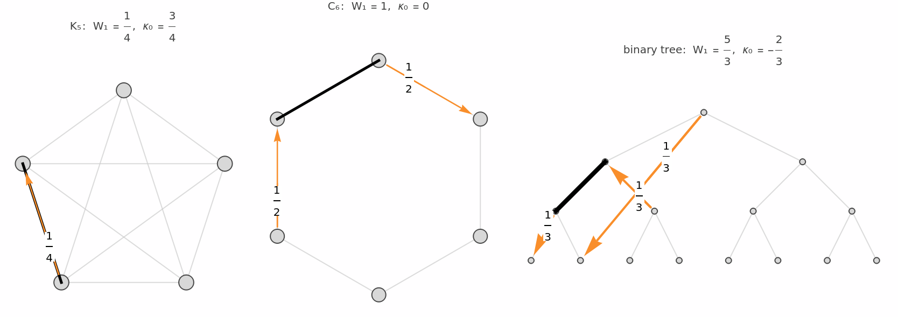
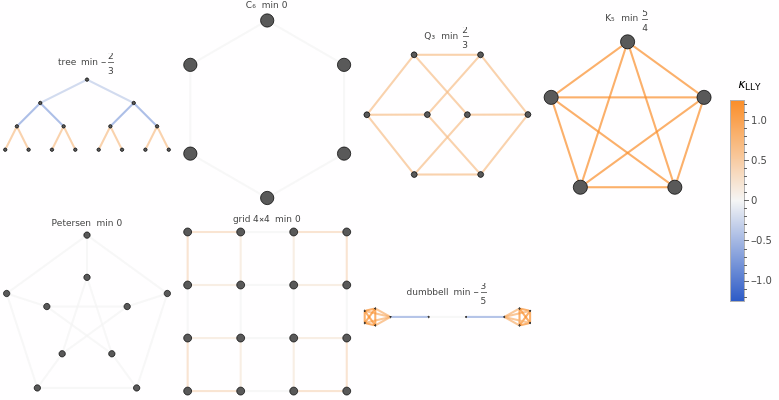
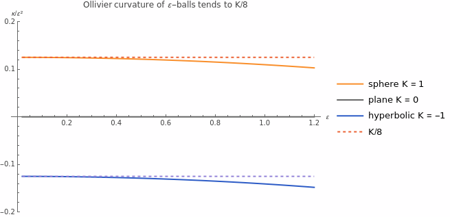

# Ollivier Curvature

23 November 2026 · Computational Classnotes · Curvature from the Laplacian, write-up 7

Positive curvature brings averages together. Ollivier’s curvature measures exactly that: κ(x, y) = 1 − W₁($m_{x}$, $m_{y}$)/d(x, y), how much closer two averaging measures are than their centres. It needs only a distance and an averaging rule, so the same definition works on graphs and on manifolds, and on a surface with ε-balls it gives back the Gauss curvature as κ ≈ Kε²/8. This write-up states and explains each part; the notebook `notebooks/series/07-Ollivier.nb` proves each one on examples, with the same section numbers.

## Scope and conventions

- **Distances.** On graphs d is the shortest-path distance; on surfaces, geodesic distance.
- **Averaging.** $\mu_{\alpha}$(x) is the α-lazy simple random walk: mass α stays at x, and 1 − α is spread evenly over the neighbours. $\kappa_{\alpha}$ is the curvature it gives; κ₀ is the non-lazy one.
- **Laplacian.** Δf(v) = (mean of f over the neighbours of v) − f(v), the random-walk normalisation, as in the rest of the series.
- **Numbering.** Sections 2–10 here match notebook Sections 2–10; notebook Section 1 is the toolkit. Every number quoted below was returned by the Wolfram kernel.
- **Repository.** https://github.com/lossofgenerality/laplacian · Lab bench: [Ollivier on manifolds](https://lossofgenerality.github.io/laplacian/lab/Laplacian_Curvature_Lab.html#ollivier).

## At a glance

**On a sphere, a ball slid along a geodesic lands with every point moving less than the centres: κ > 0.**

**Fig. 1.** The ε-ball at x on the unit sphere slid by a rotation onto the ε-ball at y. A point at distance λ from the geodesic travels δ cos λ, not δ. Averaging cos λ over the ball gives the curvature (§8, Fig. 5).

## 2. Positive curvature brings averages together

On a round sphere, geodesics leaving nearby points in parallel bend towards each other. So a small ball around x, slid to a nearby point y, needs less transport than the distance between the centres. On a plane every point travels exactly d(x, y). On a saddle, points off the geodesic travel more.

Ollivier turned this into a definition that needs no derivatives: curvature is how much closer the two averaging measures are than their centres.

## 3. Definition

Give each point x a probability measure $m_{x}$. The Wasserstein-1 distance is the least average distance needed to move one measure onto another:

$$
W_1(m,m') \;=\; \min_{\pi}\ \sum_{a,b}\pi(a,b)\,d(a,b),\qquad \pi\ge 0,\ \ \textstyle\sum_b\pi(a,b)=m(a),\ \ \sum_a\pi(a,b)=m'(b).
$$

Ollivier’s curvature of a pair x ≠ y is

$$
\kappa(x,y) \;=\; 1-\frac{W_1(m_x,m_y)}{d(x,y)} .
$$

Kantorovich–Rubinstein duality gives the same W₁ as a maximum over 1-Lipschitz test functions:

$$
W_1(m,m') \;=\; \max_{|f(a)-f(b)|\le d(a,b)}\ \Big(\sum_a f(a)\,m(a)-\sum_b f(b)\,m'(b)\Big).
$$

So a transport plan bounds W₁ above (κ below), and a 1-Lipschitz function bounds W₁ below (κ above). When the two meet, the value is proved.

**Checked (notebook §3):** primal and dual linear programs agree on five edges — C₆ 1 = 1, K₅ 1/4 = 1/4, binary tree 5/3 = 5/3, Petersen 4/3 = 4/3, cube Q₃ 1 = 1.

## 4. Worked by hand

**Complete graph Kₙ.** The walks at adjacent x and y share the n − 2 common neighbours, each with mass 1/(n − 1). Only the mass on y must move to x, a distance 1. The test function f = 1 at y, 0 elsewhere gives the same 1/(n − 1), so

$$
W_1=\frac{1}{n-1},\qquad \kappa_0(K_n)=\frac{n-2}{n-1}.
$$

**Long cycles are flat.** On Cₙ with n ≥ 4, take x = 1, y = 2. Move the ½ on 0 to 1 and the ½ on 2 to 3: W₁ ≤ 1. The function f = 1 on {0, 2}, 0 elsewhere, gives exactly 1. So κ₀(Cₙ) = 0, and κ₀(C₃) = ½.

**Trees spread out.** On an interior edge of the binary tree (both degrees 3), one optimal plan moves ⅓ a distance 1, another ⅓ a distance 1, and the last ⅓ across the edge a distance 3:

$$
W_1=\tfrac13+\tfrac13+1=\tfrac53,\qquad \kappa_0=-\tfrac23 .
$$

**Fig. 2.** Optimal transport plans on K₅, C₆ and the binary tree. The edge is black; orange arrows are the mass moved, labelled by amount.

**Checked (notebook §4):** κ₀(Kₙ) = 1/2, 2/3, 3/4, 4/5, 5/6 for n = 3…7, equal to (n − 2)/(n − 1); κ₀(Cₙ) = 1/2, 0, 0, 0, 0, 0 for n = 3…8; tree edge (2, 4): κ₀ = −2/3 with plan {1→9: ⅓, 4→8: ⅓, 5→2: ⅓}.

## 5. Laziness and the Lin–Lu–Yau curvature

The non-lazy walk misreads bipartite graphs. On the cube Q₃ the walk at x lives on odd vertices and the walk at y on even ones, so every unit of mass must move and κ₀ = 0. Laziness repairs this.

The idleness function α ↦ $\kappa_{\alpha}$(x, y) is concave and piecewise linear. On [1/(max{$d_{x}$, $d_{y}$} + 1), 1] it is linear and vanishes at α = 1 (Bourne, Cushing, Liu, Münch and Peyerimhoff). Lin, Lu and Yau defined $\kappa_{\mathrm{LLY}}$ = lim $\kappa_{\alpha}$/(1 − α) as α → 1, so for every α in that interval

$$
\kappa_{\mathrm{LLY}}(x,y)=\frac{\kappa_\alpha(x,y)}{1-\alpha},\qquad\text{in particular}\quad \kappa_{\mathrm{LLY}}=2\,\kappa_{1/2}.
$$

Münch and Wojciechowski removed the limit. The Lin–Lu–Yau curvature is a formula in the graph Laplacian:

$$
\kappa_{\mathrm{LLY}}(x,y)=\inf\big\{\,\nabla_{xy}\Delta f \;:\; f\ \text{1-Lipschitz},\ f(y)-f(x)=1\,\big\},\qquad \nabla_{xy}g=g(x)-g(y).
$$

**Fig. 3.** Idleness functions on seven edges. Each one is linear from the black dot at α = 1/(d + 1) to zero at α = 1. K₅ peaks at κ = 1 exactly there.

**Checked (notebook §5):** on seven edges $\kappa_{\alpha}$/(1 − α) takes one value for every α ≥ 1/(d + 1), and it equals the Laplacian formula — K₅ 5/4, C₆ 0, Q₃ 2/3, Petersen 0, binary tree −2/3, dumbbell bridge −3/5, star K₁,₄ 1/2.

## 6. A gallery of graphs

**Fig. 4.** Seven graphs with every edge coloured by $\kappa_{\mathrm{LLY}}$. Complete graphs and cubes are positive. Cycles and grid interiors are flat, while grid boundary edges are positive. Trees and the dumbbell’s bridge path are negative; the bridge is the most negative part of its graph.

## 7. What a lower bound on κ buys

**Local to global.** On a graph it is enough to bound κ on edges. W₁ is a metric, so the triangle inequality adds up along a geodesic (Ollivier, Proposition 19).

**Bonnet–Myers.** If $\kappa_{\mathrm{LLY}}$ ≥ k > 0 on every edge, the graph is finite and

$$
\operatorname{diam}(G)\le \frac{2}{k}.
$$

**Lichnerowicz.** Under the same hypothesis, the first non-zero eigenvalue of the normalised Laplacian satisfies

$$
\lambda_1 \ge k ,
$$

and Ollivier proves the same with his κ (Corollary 30).

The cube is extremal for both. Ollivier’s own example is the lazy walk on {0, 1}ᴺ, with κ = 1/N on neighbours.

**Checked (notebook §7):**

- **Local to global:** on Q₃ with the ½-lazy walk, pairs at distance 1, 2 and 3 all have $\kappa_{1/2}$ = 1/3.
- **Diameter:** K₅ has k = 5/4 and diam 1 ≤ 8/5. Q₃ has k = 2/3 and diam 3 = 3, equality. The star has k = 1/2 and diam 2 ≤ 4; K₃,₃ has k = 2/3 and diam 2 ≤ 3.
- **Spectral gap:** K₅ λ₁ = 1.25 = $\kappa_{\mathrm{LLY}}$ and Q₃ λ₁ = 0.6667 = $\kappa_{\mathrm{LLY}}$, both equality; the star has λ₁ = 1 ≥ 1/2.

## 8. Back on a surface: κ ≈ Kε²/8

Let $m_{x}$ be the uniform measure on the geodesic ε-ball around x, on a surface of constant curvature K, and let y lie a small distance δ along a geodesic. Slide the ball along the geodesic. The Jacobi equation J″ + KJ = 0 says a point at signed distance λ from the geodesic is displaced by δ cos(√K λ) + o(δ). Averaging over the ball,

$$
W_1(m_x,m_y)\le \delta\,\mathbb E\big[\cos(\sqrt K\,\lambda)\big]+o(\delta),
\qquad
\kappa \;\ge\; 1-\mathbb E\big[\cos(\sqrt K\,\lambda)\big]=\frac K2\,\mathbb E[\lambda^2]+O(\varepsilon^4).
$$

On a flat disc of radius ε, 𝔼[λ²] = ε²/4, so κ ≈ Kε²/8. Ollivier shows the sliding coupling is optimal at this order (Example 7). In dimension N the same computation gives

$$
\kappa(x,y)=\frac{\varepsilon^2\,\mathrm{Ric}(v,v)}{2(N+2)}+O(\varepsilon^3+\varepsilon^2\delta).
$$

In polar coordinates (ρ, α) at x, spherical trigonometry gives sin(√K λ) = sin(√K ρ) sin α, so the sliding value is an exact integral. Its series, for any K, is

$$
\kappa_{\text{slide}}(\varepsilon)=\frac{K\varepsilon^2}{8}-\frac{K^2\varepsilon^4}{64}+\frac{11K^3\varepsilon^6}{46080}+O(\varepsilon^8).
$$

The ε⁴ and higher terms belong to this coupling: they bound κ from below but are not claimed to be the exact W₁.

**Fig. 5.** κ/ε² against ε for the sphere (K = 1), the plane and the hyperbolic plane (K = −1), tending to K/8.

**Checked (notebook §8):**

- 𝔼[λ²] = ε²/4 exactly.
- The series above, symbolic in K.
- On the unit 3-sphere (Ric = 2): ε²/5 − 2ε⁴/75, whose leading term is ε²·2/(2·5).
- At ε = 0.05: κ/ε² = 0.12496 (sphere), 0 (plane), −0.12504 (hyperbolic plane).
- Series and quadrature agree at ε = 0.3 to 3 × 10⁻⁸.

## 9. Exercises

1. Show by a plan and a test function that κ₀ = 0 on every edge of K₃,₃.
2. Compute $\kappa_{1/2}$ on an edge of C₄ and of C₅. *(1/2 and 1/4.)*
3. A tree edge with degrees $d_{x}$, $d_{y}$ has $\kappa_{\mathrm{LLY}}$ = 2/$d_{x}$ + 2/$d_{y}$ − 2. Check the star K₁,₄ and both kinds of binary-tree edge. *(1/2; −2/3 interior, 2/3 at a leaf.)*
4. Show $\kappa_{\mathrm{LLY}}$ = 2/n on the hypercube Qₙ, so the diameter bound is attained for every n.
5. Prove 𝔼[λ²] = ε²/4 on a flat disc and deduce K/8.

**Checked (notebook §9):** κ₀(K₃,₃) = 0; $\kappa_{1/2}$(C₄) = 1/2 and $\kappa_{1/2}$(C₅) = 1/4; the tree formula holds on all three edges; $\kappa_{\mathrm{LLY}}$(Qₙ) = 1, 2/3, 1/2, 2/5 with diam = 2, 3, 4, 5 for n = 2…5.

## Verified results

| Graph and edge | κ₀ | $\kappa_{1/2}$ | $\kappa_{\mathrm{LLY}}$ | λ₁ | diam |
|---|---|---|---|---|---|
| K₅ | 3/4 | 5/8 | 5/4 | 1.25 | 1 |
| C₆ | 0 | 0 | 0 | 0.5 | 3 |
| Q₃ | 0 | 1/3 | 2/3 | 0.667 | 3 |
| Petersen, edge {1, 3} | −1/3 | 0 | 0 | 0.667 | 2 |
| Binary tree, interior edge | −2/3 | −1/3 | −2/3 | 0.057 | 6 |
| Dumbbell, bridge {5, 6} | −3/5 | −3/10 | −3/5 | 0.029 | 5 |
| Star K₁,₄ | 0 | 1/4 | 1/2 | 1 | 2 |

In every row $\kappa_{\mathrm{LLY}}$ = 2$\kappa_{1/2}$. Where $\kappa_{\mathrm{LLY}}$ > 0 the spectral bound holds (K₅ and Q₃ with equality), and Q₃ meets the diameter bound 2/$\kappa_{\mathrm{LLY}}$ = 3.

## References

**Ollivier curvature**

- Y. Ollivier, *Ricci curvature of Markov chains on metric spaces*, J. Funct. Anal. 256 (2009) 810–864. [arXiv:math/0701886](https://arxiv.org/abs/math/0701886). Example 7 (ε-balls), Example 8 (cube), Proposition 19 (local to global), Proposition 23 (diameter), Corollary 30 (spectral gap).

**Lin–Lu–Yau curvature and laziness**

- Y. Lin, L. Lu, S.-T. Yau, *Ricci curvature of graphs*, Tohoku Math. J. 63 (2011) 605–627. [Project Euclid](https://www.projecteuclid.org/euclid.tmj/1325886283) (record page opened; full text not reachable from here).
- D. P. Bourne, D. Cushing, S. Liu, F. Münch, N. Peyerimhoff, *Ollivier–Ricci idleness functions of graphs*, SIAM J. Discrete Math. 32 (2018) 1408–1424. [arXiv:1704.04398](https://arxiv.org/abs/1704.04398).
- F. Münch, R. K. Wojciechowski, *Ollivier Ricci curvature for general graph Laplacians*, Adv. Math. 356 (2019) 106759. [arXiv:1712.00875](https://arxiv.org/abs/1712.00875). Theorem 2.1 (limit-free formula).

**Consequences**

- X. Huang, S. Liu, Q. Xia, *Bounding the diameter and eigenvalues of amply regular graphs via Lin–Lu–Yau curvature*. [arXiv:2210.02988](https://arxiv.org/abs/2210.02988). Theorem 1.2 states the discrete Bonnet–Myers bound and the Lichnerowicz estimate.

© Computational Classnotes · CC BY-NC-SA 4.0
