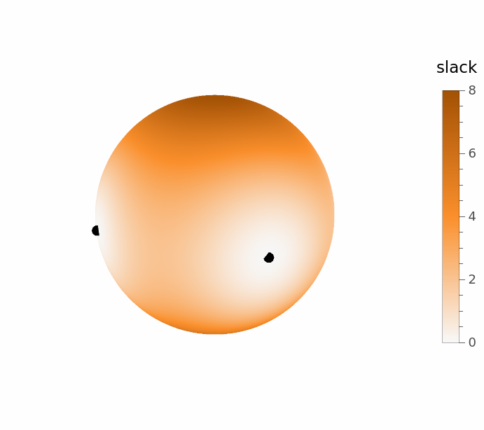
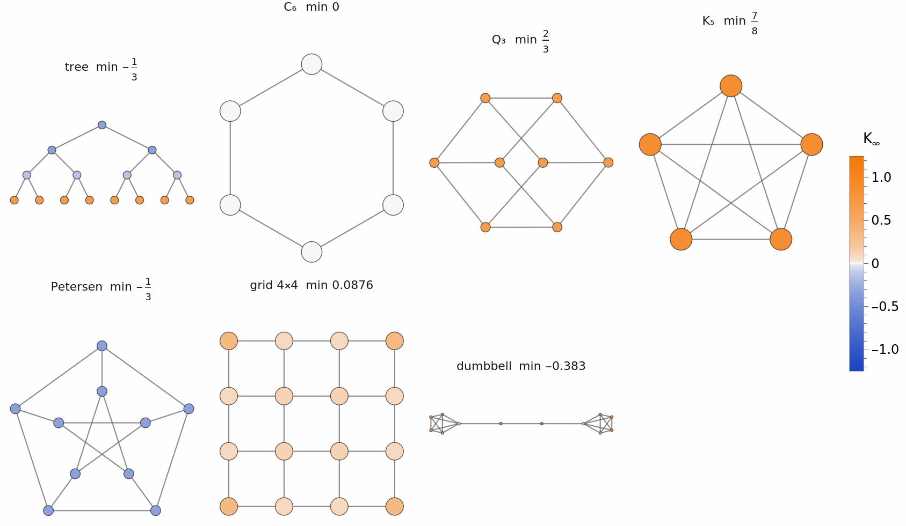
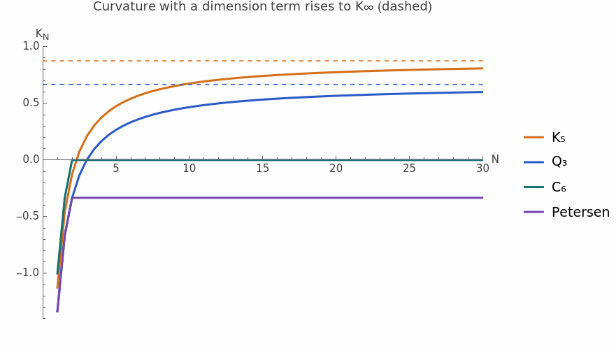

# Bakry–Émery Curvature

23 November 2026 · Computational Classnotes · Curvature from the Laplacian, write-up 9

Ricci curvature is what is left over in Bochner’s formula: Γ₂(f) = |Hess f|² + Ric(∇f, ∇f). Bakry and Émery noticed that both sides can be written with the Laplacian alone, through the *carré du champ* Γ and its iterate Γ₂, defined in §2. So the inequality Γ₂ ≥ (1/N)(Δf)² + KΓ makes sense wherever there is a Laplacian, including on a graph, and the best K is a curvature. On the round sphere it recovers Ric = 1 in dimension 2, and on graphs it is a small, exact eigenvalue problem. This write-up explains each part; the notebook `notebooks/series/09-Bakry-Emery.nb` proves each one on examples, with the same section numbers.

## Scope and conventions

- **Laplacian.** Δf(v) = (mean of f over the neighbours of v) − f(v), the random-walk normalisation used throughout the series.
- **Γ-calculus.** Γ is the carré du champ and Γ₂ its iterate, both defined from Δ alone in §2. On a graph, Γ(f)(v) = ½ mean (f(w) − f(v))² over the neighbours w.
- **Curvature.** $K_{N}(x)$ is the largest K with Γ₂(f)(x) ≥ (1/N)(Δf(x))² + K Γ(f)(x) for all f; $K_{\infty}$ drops the dimension term.
- **Numbering.** Sections 2–9 here match notebook Sections 2–9; notebook Section 1 is the toolkit. Every number quoted below was returned by the Wolfram kernel.
- **Companion.** The Ollivier write-up (07) uses the same graphs, so the two curvatures can be compared (§8).
- **Repository.** https://github.com/lossofgenerality/laplacian · Lab section: [Graph curvatures](https://lossofgenerality.github.io/laplacian/lab/Laplacian_Curvature_Lab.html#graphs).

## At a glance

**On the unit sphere the Bochner inequality Γ₂ ≥ Γ + (Δg)²/2 holds everywhere, with equality only at four points for this g.**

**Fig. 1.** The slack Γ₂ − Γ − (Δg)²/2 of CD(1, 2) on the unit sphere for g = z + (x² − y²). It is zero only at the four equator points marked in black, and largest, 8, at the poles (§2). In the HTML version the sphere can be rotated.

## 2. The carré du champ, and Bochner’s formula written with the Laplacian

**The carré du champ.** *Carré du champ* is French for “square of the field”. It is the operator that recovers the squared length of the gradient, |∇f|², from the Laplacian alone. The Laplacian is not a derivation: on a manifold the product rule gives

$$
\Delta(f^2)=2f\,\Delta f+2|\nabla f|^2 ,
$$

so the failure of Δ to obey Leibniz’s rule on f² is exactly twice |∇f|². Bakry and Émery take this as the definition, for any operator Δ, and polarise it for two functions:

$$
\Gamma(f,g)=\tfrac12\big(\Delta(fg)-f\,\Delta g-g\,\Delta f\big),\qquad \Gamma(f)=\Gamma(f,f).
$$

On a manifold Γ(f, g) = ⟨∇f, ∇g⟩. On a graph the same formula gives the mean squared difference across the edges at v: Δ(f²)(v) − 2f(v)Δf(v) = mean (f(w)² − f(v)²) − 2f(v) mean (f(w) − f(v)) = mean (f(w) − f(v))², so

$$
\Gamma(f)(v)=\tfrac12\,\operatorname{mean}_{w\sim v}\big(f(w)-f(v)\big)^2 .
$$

**The iterated carré du champ.** Γ₂ repeats the construction with Γ in place of the product fg:

$$
\Gamma_2(f,g)=\tfrac12\big(\Delta\Gamma(f,g)-\Gamma(f,\Delta g)-\Gamma(\Delta f,g)\big),\qquad \Gamma_2(f)=\tfrac12\Delta\Gamma(f)-\Gamma(f,\Delta f).
$$

**Worked by hand on the line.** Take Δ = d²/dx² and f = x². Then Δf = 2 and Δ(f²) = Δ(x⁴) = 12x², so Γ(f) = ½(12x² − 2·x²·2) = 4x², which is (f′)² = (2x)². Next, Γ(f) = 4x² gives ΔΓ(f) = 8 and Γ(f, Δf) = Γ(x², 2) = 0, so Γ₂(f) = 4 = (f″)² = |Hess f|²: on the flat line Ric = 0 and Bochner’s formula below reads Γ₂ = |Hess f|².

**Checked (notebook §2):** ½(Δ(F²) − 2FΔF) − Γ(F) simplifies to 0 on S² for an arbitrary F(θ, φ) and on the Petersen graph for symbolic values at all ten vertices; for f = x² on the line it gives 4x².

**Bochner’s formula.** On a Riemannian manifold, ½Δ|∇f|² = ⟨∇f, ∇Δf⟩ + |Hess f|² + Ric(∇f, ∇f). With Γ(f) = |∇f|² and Γ₂(f) = ½ΔΓ(f) − Γ(f, Δf) this reads

$$
\Gamma_2(f)=|\operatorname{Hess} f|^2+\operatorname{Ric}(\nabla f,\nabla f).
$$

On the unit sphere S², Ric = 1, so Γ₂ − Γ = |Hess f|². In dimension 2, |Hess f|² ≥ (Δf)²/2, because the trace of a 2 × 2 symmetric matrix squared is at most twice the sum of its squared entries. So

$$
\Gamma_2(f)\ \ge\ \tfrac12(\Delta f)^2+\Gamma(f)\qquad\text{on }S^2:\ \text{the sphere satisfies }CD(1,2).
$$

Equality needs a Hessian that is a multiple of the metric. The height z = cos θ is the first eigenfunction (Δz = −2z) and attains it everywhere: Γ₂(z) = 1 + z², Γ(z) = 1 − z² and (Δz)²/2 = 2z². For g = z + (x² − y²), mixing the first two eigenspaces, the slack is

$$
\Gamma_2(g)-\Gamma(g)-\tfrac12(\Delta g)^2=8-8\sin^2\theta+\sin^4\theta\,(1+\cos4\varphi),
$$

which vanishes only where sin θ = 1 and cos 4φ = −1 (Fig. 1).

**Checked (notebook §2), Bochner:** Γ₂ − Γ − |Hess F|² simplifies to 0 for an arbitrary F(θ, φ); for z the slack is exactly 0; for g the slack equals the formula above, ranges over [0, 8], and is 1 + cos 4φ on the equator.

## 3. Definition on graphs

A graph has no Hessian and no Ricci tensor, but it has a Laplacian, so Γ and Γ₂ are defined. Bakry–Émery curvature imposes the Bochner inequality directly:

$$
\Gamma_2(f)(x)\ \ge\ \frac1N\big(\Delta f(x)\big)^2+K\,\Gamma(f)(x)\quad\text{for all }f,\qquad K_N(x)=\text{the largest such }K.
$$

Γ(f)(x) depends on f on the 1-ball of x and Γ₂(f)(x) on the 2-ball. Both are quadratic forms in those values, and constants drop out. So $K_{N}(x)$ is a finite problem. Minimise first over the values at distance 2 (a Schur complement); then $K_{N}(x)$ is the smallest generalised eigenvalue of the reduced Γ₂ − (Δf)²/N against Γ on the neighbours. This is the reformulation of Cushing, Kamtue, Liu and Peyerimhoff, and the notebook computes it exactly.

**Checked (notebook §3), minimum over vertices:** tree −1/3, C₆ 0, Q₃ 2/3, K₅ 7/8, Petersen −1/3, 4×4 grid 0.0876, dumbbell (2 − √34)/10 ≈ −0.383.

## 4. Worked by hand

**One edge K₂.** Put f(x) = 0 and f(y) = t. Then Δf(x) = t and Δf(y) = −t. Γ(f) = t²/2 at both ends, so ΔΓ(f)(x) = 0. And Γ(f, Δf)(x) = ½(t − 0)(−t − t) = −t². Hence

$$
\Gamma_2(f)(x)=0-(-t^2)=t^2,\qquad \frac{\Gamma_2}{\Gamma}=2:\quad K_\infty(K_2)=2.
$$

With the dimension term, t² − t²/N ≥ K t²/2 gives $K_{N}(K_2)$ = 2 − 2/N: 0, 1, 3/2, 9/5 for N = 1, 2, 4, 10.

**Long cycles are flat.** On Cₙ with n ≥ 5, let f be the position along the path through x, with values −2, −1, 0, 1, 2 on the 2-ball. Then Δf = 0 at x and its neighbours. Γ(f) = ½ at every vertex, so ΔΓ = 0. Hence Γ₂(f)(x) = 0 while Γ(f)(x) = ½, and $K_{\infty}$ ≤ 0. The kernel gives exactly 0; C₃ = K₃ gives 5/4 and C₄ = Q₂ gives 1.

**Complete graphs.** On Kₙ every other vertex is a neighbour, so there is no 2-ball part, and the same calculation gives

$$
K_\infty(K_n)=\frac{n+2}{2(n-1)}:\qquad 2,\ \tfrac54,\ 1,\ \tfrac78,\ \dots\ \to\ \tfrac12 .
$$

**Checked (notebook §4):** $K_{\infty}(K_2)$ = 2 and $K_{N}$ = 0, 1, 3/2, 9/5 for N = 1, 2, 4, 10; Cₙ gives 5/4, 1, 0, 0, 0, 0, 0 for n = 3 … 9; Kₙ matches (n + 2)/(2(n − 1)) for n = 2 … 8.

## 5. Families and a gallery

The hypercube $Q_{d}$ has $K_{\infty}$ = 2/d at every vertex. The binary tree is negative at the root and branch vertices and positive at the leaves. On the dumbbell the two bridge vertices are the most negative, and the vertex where a clique meets the bridge is just below zero.

**Fig. 2.** Seven graphs with every vertex coloured by $K_{\infty}$, on the same blue–white–orange scale as the Ollivier gallery. Complete graphs and cubes are positive and long cycles flat; tree branch points, Petersen and the dumbbell’s bridge are negative.

**Checked (notebook §5):** $K_{\infty}(Q_d)$ = 2, 1, 2/3, 1/2, 2/5 for d = 1 … 5. Tree: root −1/3, second level −1/3, third level (5 − √33)/6 ≈ −0.124, leaf 2/3. Dumbbell: clique vertex (93 − √793)/80 ≈ 0.81, attaching vertex (35 − √1385)/80 ≈ −0.028, bridge vertices (2 − √34)/10 ≈ −0.383.

## 6. Dimension: the curve $K_{N}$

The dimension term can only lower the curvature, so $K_{N}(x)$ increases with N and tends to $K_{\infty}(x)$. Cushing, Liu and Peyerimhoff study this curvature function N ↦ $K_{N}(x)$ systematically.

**Fig. 3.** $K_{N}$ against N on four vertex-transitive graphs. K₅ and Q₃ only approach their $K_{\infty}$ (7/8 and 2/3, dashed). C₆ and Petersen reach theirs (0 and −1/3) already at N = 2: there the function that attains $K_{\infty}$ has Δf(x) = 0, so the dimension term costs nothing.

Lin and Yau proved a universal lower bound in dimension 2: every graph with maximum degree D satisfies

$$
\Gamma_2(f)\ \ge\ \tfrac12(\Delta f)^2+\Big(\frac1D-1\Big)\Gamma(f),\qquad\text{that is}\quad K_2(x)\ \ge\ \frac1D-1 .
$$

**Checked (notebook §6):** the four curves increase in N; $K_{2}$ ≥ 1/D − 1 holds at every vertex of all seven graphs of Fig. 2.

## 7. What a lower bound buys

**Lichnerowicz.** If every vertex satisfies CD(K, N) with K > 0, the first non-zero eigenvalue of −Δ satisfies

$$
\lambda_1\ \ge\ \frac{N}{N-1}\,K,\qquad\text{and}\quad \lambda_1\ge K\ \text{ for }N=\infty .
$$

**Bonnet–Myers.** Liu, Münch and Peyerimhoff prove diam ≤ 2 $D_{\max}$/K under CD(K, ∞) for the unnormalised Laplacian, sharp on hypercubes. For a d-regular graph the normalised Laplacian here is 1/d times the unnormalised one, so K scales by 1/d and the bound reads

$$
\operatorname{diam}(G)\ \le\ \frac{2}{K_\infty}\qquad(G\ \text{regular}).
$$

| Graph | λ₁ | $K_{\infty}$ | best NK/(N − 1), N ≤ 50 | diam | 2/$K_{\infty}$ |
|---|---|---|---|---|---|
| K₃ | 1.5 | 5/4 | 1.235 | 1 | 8/5 |
| K₅ | 1.25 | 7/8 | 0.852 | 1 | 16/7 |
| Q₃ | 0.667 | 2/3 | 0.639 | 3 | 3 |
| Q₄ | 0.5 | 1/2 | 0.469 | 4 | 4 |

**Checked (notebook §7):** λ₁ ≥ $K_{\infty}$ in every row, with equality on Q₃ and Q₄. On these graphs the N = ∞ bound is the strongest, since the best finite-N bound is lower. diam ≤ 2/$K_{\infty}$ in every row, with equality on Q₂, Q₃ and Q₄.

## 8. Bakry–Émery and Ollivier side by side

Both curvatures copy one property of Ricci curvature: Bakry–Émery the Bochner formula, Ollivier the transport of small balls. On these graphs they agree in sign but not in size.

| Graph | $K_{\infty}$ (min) | $\kappa_{\mathrm{LLY}}$ (min, write-up 07) |
|---|---|---|
| K₅ | 7/8 | 5/4 |
| Q₃ | 2/3 | 2/3 |
| C₆ | 0 | 0 |
| Petersen | −1/3 | 0 |
| 4×4 grid | 0.0876 | 0 |

**Checked (notebook §8):** Q₃ gives 2/3 for both; on K₅ Ollivier is larger; on Petersen Bakry–Émery is negative while Lin–Lu–Yau is 0; on the grid Bakry–Émery is slightly positive at every vertex while Lin–Lu–Yau has flat edges.

## 9. Exercises

1. Show by hand that $K_{\infty}(K_3)$ = 5/4.
2. Derive $K_{N}(K_2)$ = 2 − 2/N from the K₂ calculation in §4.
3. Find f on C₄ with Γ₂(f) = Γ(f) at a vertex, so $K_{\infty}(C_4)$ ≤ 1.
4. Prove $K_{\infty}(Q_d)$ ≤ 2/d with f = one coordinate.
5. On S², show that the slack of g is 8 − 8 sin²θ + sin⁴θ (1 + cos 4φ) and find its four zeros.

**Checked (notebook §9):** $K_{\infty}(K_3)$ = 5/4, $K_{\infty}(C_4)$ = 1, and the slack is 0 at θ = π/2, φ = π/4.

## Verified results

| Graph | $K_{\infty}$ (min over vertices) | exact form | λ₁ | diam |
|---|---|---|---|---|
| K₂ | 2 | 2 | — | 1 |
| K₅ | 0.875 | 7/8 | 1.25 | 1 |
| Q₃ | 0.667 | 2/3 | 0.667 | 3 |
| C₆ | 0 | 0 | 0.5 | 3 |
| Petersen | −0.333 | −1/3 | 0.667 | 2 |
| 4×4 grid | 0.0876 | algebraic | — | 6 |
| Binary tree (15 vertices) | −0.333 | −1/3 | 0.057 | 6 |
| Dumbbell | −0.383 | (2 − √34)/10 | 0.029 | 5 |

$K_{\infty}$ is exact in every row. Where it is positive, the Lichnerowicz bound λ₁ ≥ $K_{\infty}$ holds, with equality on Q₃. The λ₁ values for C₆, Petersen, the tree and the dumbbell are from write-up 07.

## References

Every item below was opened (abstract or full text) on 23 November 2026 unless marked otherwise; the notes say what each contributes.

**1. The Γ-calculus and curvature-dimension**

- D. Bakry, M. Émery, *Diffusions hypercontractives*, Séminaire de probabilités XIX, Lecture Notes in Math. 1123, Springer (1985), 177–206. [doi:10.1007/BFb0075847](https://doi.org/10.1007/BFb0075847), [Numdam](https://www.numdam.org/item/SPS_1985__19__177_0/). The Γ₂ criterion: a strong positivity of Γ₂ gives hypercontractivity.
- D. Bakry, I. Gentil, M. Ledoux, *Analysis and Geometry of Markov Diffusion Operators*, Grundlehren der mathematischen Wissenschaften 348, Springer (2014). [doi:10.1007/978-3-319-00227-9](https://doi.org/10.1007/978-3-319-00227-9). The standard reference for Γ, Γ₂ and CD(K, N), with Poincaré, Sobolev and log-Sobolev consequences.
- D. Bakry, M. Ledoux, *Sobolev inequalities and Myers’s diameter theorem for an abstract Markov generator*, Duke Math. J. 85 (1996), no. 1, 253–270. Cited from the reference list of Liu–Münch–Peyerimhoff; not opened.

**2. From diffusions to graphs**

- M. Schmuckenschläger, *Curvature of nonlocal Markov generators*, in *Convex Geometric Analysis*, MSRI Publications 34 (1998), from p. 189. [PDF](https://library.slmath.org/books/Book34/files/schmuck1.pdf). Extends the curvature-dimension condition to nonlocal generators, which gives a curvature for graphs, local to the 2-ball.
- Y. Lin, S.-T. Yau, *Ricci curvature and eigenvalue estimate on locally finite graphs*, Math. Res. Lett. 17 (2010), no. 2, 343–356. [doi:10.4310/MRL.2010.v17.n2.a13](https://doi.org/10.4310/MRL.2010.v17.n2.a13). CD on graphs, the universal bound K₂ ≥ 1/D − 1 (§6), and eigenvalue estimates.
- Y. Lin, S.-T. Yau, *A brief review on geometry and spectrum of graphs*. [arXiv:1204.3168](https://arxiv.org/abs/1204.3168). States Γ₂ ≥ ½(Δf)² + (1/d − 1)Γ in the normalisation used here.

**3. Curvature functions and computation**

- D. Cushing, S. Liu, N. Peyerimhoff, *Bakry–Émery curvature functions on graphs*, Canad. J. Math. 72 (2020), no. 1, 89–143. [doi:10.4153/CJM-2018-015-4](https://doi.org/10.4153/CJM-2018-015-4), [arXiv:1606.01496](https://arxiv.org/abs/1606.01496). The function N ↦ $K_{N}(x)$ (§6), products, Cayley and strongly regular graphs.
- D. Cushing, S. Kamtue, S. Liu, N. Peyerimhoff, *Bakry–Émery curvature on graphs as an eigenvalue problem*, Calc. Var. Partial Differential Equations 61 (2022), 62. [arXiv:2102.08687](https://arxiv.org/abs/2102.08687). The Schur-complement eigenvalue formulation used in the notebook (§3).
- D. Cushing, R. Kangaslampi, V. Lipiäinen, S. Liu, G. W. Stagg, *The Graph Curvature Calculator and the curvatures of cubic graphs*, Experiment. Math. 31 (2022), no. 2, 583–595. [doi:10.1080/10586458.2019.1660740](https://doi.org/10.1080/10586458.2019.1660740), [arXiv:1712.03033](https://arxiv.org/abs/1712.03033). Classifies the non-negatively curved cubic graphs (prisms and Möbius ladders) for both Ollivier and Bakry–Émery; the online [Graph Curvature Calculator](https://www.mas.ncl.ac.uk/graph-curvature) gives an independent check of the values here.

**4. Consequences: spectrum, diameter, heat kernels**

- F. Bauer, F. Chung, Y. Lin, Y. Liu, *Curvature aspects of graphs*, Proc. Amer. Math. Soc. 145 (2017), no. 5, 2033–2042. [doi:10.1090/proc/13145](https://doi.org/10.1090/proc/13145). Lichnerowicz-type eigenvalue bounds under CD (§7).
- S. Liu, F. Münch, N. Peyerimhoff, *Bakry–Émery curvature and diameter bounds on graphs*, Calc. Var. Partial Differential Equations 57 (2018), no. 2, 67. [doi:10.1007/s00526-018-1334-x](https://doi.org/10.1007/s00526-018-1334-x), [arXiv:1608.07778](https://arxiv.org/abs/1608.07778). Discrete Bonnet–Myers, diam ≤ 2 $D_{\max}$/K, sharp on hypercubes (§7).
- S. Liu, F. Münch, N. Peyerimhoff, C. Rose, *Distance bounds for graphs with some negative Bakry–Émery curvature*. [arXiv:1705.08119](https://arxiv.org/abs/1705.08119). Diameter bounds when the curvature is positive outside an exceptional set.
- F. Bauer, P. Horn, Y. Lin, G. Lippner, D. Mangoubi, S.-T. Yau, *Li–Yau inequality on graphs*, J. Differential Geom. 99 (2015), 359–405. Cited from a reference list; not opened. The exponential curvature-dimension condition CDE.
- P. Horn, Y. Lin, S. Liu, S.-T. Yau, *Volume doubling, Poincaré inequality and Gaussian heat kernel estimate for non-negatively curved graphs*, J. Reine Angew. Math. 757 (2019), 89–130. Cited from a reference list; not opened.
- B. Hua, Y. Lin, *Stochastic completeness for graphs with curvature dimension conditions*, Adv. Math. 306 (2017), 279–302. Cited from a reference list; not opened.
- F. Münch, *Remarks on curvature dimension conditions on graphs*, Calc. Var. Partial Differential Equations 56 (2017), no. 1, 11. Cited from a reference list; not opened.

**5. Related curvatures**

- J. Jost, S. Liu, *Ollivier’s Ricci curvature, local clustering and curvature-dimension inequalities on graphs*, Discrete Comput. Geom. 51 (2014), no. 2, 300–322. [doi:10.1007/s00454-013-9558-1](https://doi.org/10.1007/s00454-013-9558-1). Relates Ollivier curvature to curvature-dimension inequalities (§8).
- B. Klartag, G. Kozma, P. Ralli, P. Tetali, *Discrete curvature and abelian groups*, Canad. J. Math. 68 (2016), no. 3, 655–674. Cited from a reference list; not opened. Bakry–Émery curvature of Cayley graphs of abelian groups.
- M. Erbar, J. Maas, *Ricci curvature of finite Markov chains via convexity of the entropy*, Arch. Ration. Mech. Anal. (2012). [arXiv:1111.2687](https://arxiv.org/abs/1111.2687). The entropic curvature, a third discrete Ricci curvature.
- Y. Ollivier, *Ricci curvature of Markov chains on metric spaces*, J. Funct. Anal. 256 (2009), 810–864. [arXiv:math/0701886](https://arxiv.org/abs/math/0701886). The transport curvature of write-up 07.

© Computational Classnotes · CC BY-NC-SA 4.0
